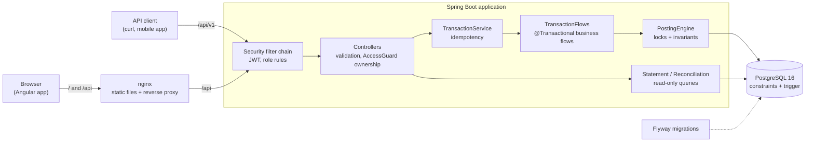
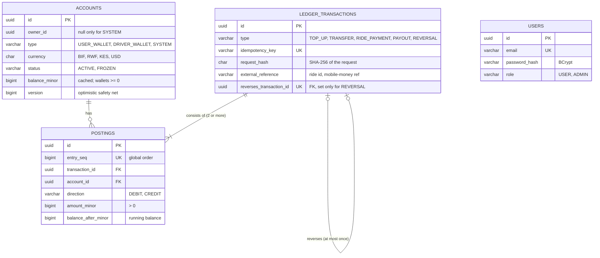

# wallet-ledger-api

[](https://github.com/tom-cruiser/effective-system/actions/workflows/ci.yml)


A double-entry wallet ledger for a ride-sharing platform, built with Java 21 and Spring Boot.

Riders top up their wallets with mobile money and pay for rides. Drivers receive their share and
are paid out, and the platform keeps a commission. Every one of those money movements is recorded
as a **balanced, immutable journal entry**. Balances can never go negative, even under concurrent
load, and a retried request can never charge anyone twice.

**What this project demonstrates:**

- **Correct money handling.** Amounts are integer minor units, every entry balances, and history is
  append-only.
- **Concurrency control.** Pessimistic row locks taken in a fixed order prevent double-spending
  and deadlocks. Tests with 100 concurrent requests prove it.
- **Idempotent APIs.** Safe retries over unreliable mobile networks.
- **Defence in depth.** Each rule is enforced in the domain code, and again by PostgreSQL
  constraints and a trigger where the database can express it.
- **Production habits.** Flyway migrations, RFC 7807 errors with stable codes, JWT security,
  OpenAPI docs, Testcontainers, a coverage gate, Docker and CI.

## Contents

- [Quick start](#quick-start)
- [Architecture](#architecture)
- [Data model](#data-model)
- [The accounting model](#the-accounting-model)
- [Worked example: a 10,000 BIF ride](#worked-example-a-10000-bif-ride)
- [The eight invariants](#the-eight-invariants)
- [Design decisions](#design-decisions)
- [API](#api)
- [Web client (Angular)](#web-client-angular)
- [Testing](#testing)
- [Tech stack](#tech-stack)
- [Project structure](#project-structure)
- [What I would add next](#what-i-would-add-next)

## Quick start

Requirements: Docker. Building and testing with `./mvnw` also needs a JDK 21; the frontend needs
Node 24.

```bash
docker compose up --build
```

| What | URL |
|---|---|
| Web app | <http://localhost:4200> |
| Swagger UI | <http://localhost:8080/swagger-ui.html> |
| Health | <http://localhost:8080/actuator/health> |

If ports 4200, 8080 or 5432 are already taken on your machine:

```bash
WEB_PORT=4201 APP_PORT=8081 DB_PORT=5434 docker compose up --build
```

### Demo users

> ⚠️ **Demo only.** These accounts are seeded by `V3__users.sql` and their passwords are public.
> Their passwords are stored as BCrypt hashes, like any other user's.

| Email | Password | Role |
|---|---|---|
| `rider@demo.local` | `rider-demo-123` | USER: can read, and move money out of, only the wallets it owns |
| `admin@demo.local` | `admin-demo-123` | ADMIN: every account, plus reversals and reconciliation |

JWTs are signed with HS256 using the `JWT_SECRET` environment variable (at least 32 bytes). The
application refuses to start without it. `docker-compose.yml` supplies a value that is clearly
marked local-only. No real secret is committed.

## Architecture



The request path for a money movement, layer by layer:

1. **Security filter chain.** Rejects a missing or invalid token (`401`) and a wrong role (`403`).
2. **Controller.**
   - Validates the body (`400`).
   - `AccessGuard` checks that the caller owns the account money leaves from (`403`).
3. **`TransactionService`.** Looks up the `Idempotency-Key`. A replay returns the stored
   transaction (`200`).
4. **`TransactionFlows`.** Opens the database transaction and builds the journal entry, such as
   the ride's fee split.
5. **`PostingEngine`.**
   - Locks every affected account in ascending id order.
   - Checks the invariants on the locked rows.
   - Writes the transaction, its postings and the new cached balances.
6. **PostgreSQL.** Commits, or rejects anything that slipped through: a negative wallet, a
   duplicate key, a second reversal, or a modified posting.

Packages are organised by feature (`account`, `transaction`, `statement`, `reconciliation`,
`security`), with shared building blocks in `common`.

## Data model



`users` has no foreign key to `accounts`: `owner_id` is an opaque id, as if users lived in a
separate identity service. Personal data therefore stays out of the immutable ledger.

## The accounting model

**Double entry.** Every transaction is a set of postings (lines) in which total debits equal total
credits. Money is never created or destroyed. It only moves between accounts, so the ledger can
always prove where every unit came from.

**Sign convention.** Every account is *credit-normal*: a CREDIT adds to its balance and a DEBIT
subtracts from it.

```
balance = sum(credits) - sum(debits)
```

Wallets therefore read naturally: money in is a credit, money out is a debit. Because every entry
balances, **all balances in one currency always sum to exactly zero**. Reconciliation checks this.

**System accounts.** There is one of each per currency, created by Flyway. They represent the
outside world and the platform:

| Account | Role | Usual balance |
|---|---|---|
| `TOPUP_CLEARING` | Money arriving from mobile-money providers | Negative: money held at the provider on users' behalf |
| `PAYOUT_CLEARING` | Money owed out to drivers' mobile-money accounts | Positive until settled with the provider |
| `PLATFORM_FEES` | The platform's commission | Positive: revenue |

**Transaction types:**

| Type | Debit | Credit |
|---|---|---|
| `TOP_UP` | `TOPUP_CLEARING` | user wallet |
| `TRANSFER` | sender wallet | recipient wallet |
| `RIDE_PAYMENT` | rider wallet (full fare) | driver wallet (fare − fee) **and** `PLATFORM_FEES` (fee) |
| `PAYOUT` | driver wallet | `PAYOUT_CLEARING` |
| `REVERSAL` | the original's credits | the original's debits |

## Worked example: a 10,000 BIF ride

The platform fee is 15% (`LEDGER_PLATFORM_FEE_BPS=1500`). BIF has no minor unit, so 10,000 BIF is
stored as `10000`.

**1. The rider tops up 20,000 BIF via mobile money.**

| Account | Direction | Amount | Balance after |
|---|---|---:|---:|
| `TOPUP_CLEARING` (BIF) | DEBIT | 20,000 | −20,000 |
| Rider wallet | CREDIT | 20,000 | 20,000 |

**2. The rider pays a 10,000 BIF fare.**

- Fee = `floor(10,000 × 1,500 / 10,000)` = 1,500.
- Driver share = fare − fee = 8,500.

| Account | Direction | Amount | Balance after |
|---|---|---:|---:|
| Rider wallet | DEBIT | 10,000 | 10,000 |
| Driver wallet | CREDIT | 8,500 | 8,500 |
| `PLATFORM_FEES` (BIF) | CREDIT | 1,500 | 1,500 |

Debits (10,000) = credits (8,500 + 1,500). If the fee does not divide evenly, it is rounded
*down*, and the driver receives the remainder. For a fare of 10,001 the fee is 1,500 and the
driver gets 8,501, so no unit is ever lost to rounding.

**3. The driver is paid out 8,500 BIF.**

| Account | Direction | Amount | Balance after |
|---|---|---:|---:|
| Driver wallet | DEBIT | 8,500 | 0 |
| `PAYOUT_CLEARING` (BIF) | CREDIT | 8,500 | 8,500 |

**Check.** −20,000 (top-up clearing) + 10,000 (rider) + 0 (driver) + 1,500 (fees) + 8,500 (payout
clearing) = **0**.

If an admin now tries to reverse the ride, the API refuses with `422 INSUFFICIENT_FUNDS`. Taking
the 8,500 back from the driver would make their wallet negative, and the ledger will not guess how
to recover money that has already left ([ADR 0003](docs/adr/0003-immutable-ledger-with-reversals.md)).

## The eight invariants

| # | Invariant | Enforced by | Proven by |
|---|---|---|---|
| 1 | A transaction has at least 2 postings | `PostingEngine` | `PostingEngineTest.invariant1_*` |
| 2 | Debits equal credits; every amount is > 0 | `PostingEngine`; DB `CHECK (amount_minor > 0)`; reconciliation detects violations | `PostingEngineTest.invariant2_*`, `ReconciliationApiIT` |
| 3 | One currency per transaction, matching every account | `PostingEngine`, `Money`; DB currency `CHECK`s | `PostingEngineTest.invariant3_*`, `TransferApiIT` |
| 4 | Wallets never go negative (system accounts may) | `PostingEngine` after locking; DB `CHECK (type = 'SYSTEM' OR balance_minor >= 0)` | `PostingEngineTest.invariant4_*`, `ConcurrencyIT` |
| 5 | Postings are immutable; corrections are reversals, at most one per transaction | `@Immutable` entities; DB trigger blocks `UPDATE`/`DELETE`/`TRUNCATE`; `UNIQUE (reverses_transaction_id)` | `PostingImmutabilityIT`, `ReversalApiIT` |
| 6 | Frozen accounts cannot be debited or credited | `PostingEngine` | `PostingEngineTest.invariant6_*`, `TransferApiIT`, `TopUpApiIT` |
| 7 | Idempotency: same key + same body → `200` with the original; different body → `409` | `TransactionService`; DB `UNIQUE (idempotency_key)` | `IdempotencyApiIT` (including 10 concurrent duplicates) |
| 8 | Cached balance = balance derived from postings | Written in the same DB transaction; `@Version`; reconciliation | `ConcurrencyIT`, `ReconciliationApiIT` |

`GET /api/v1/admin/reconciliation` re-checks invariants 2, 3 and 8 across the whole database in
one `REPEATABLE READ` snapshot.

## Design decisions

The four main decisions each have an Architecture Decision Record with context, alternatives and
trade-offs:

| ADR | Decision | In one line |
|---|---|---|
| [0001](docs/adr/0001-money-as-minor-units.md) | Money as `long` minor units | `0.1 + 0.2 ≠ 0.3` in floating point; integers are exact and fast, and overflow fails loudly |
| [0002](docs/adr/0002-pessimistic-locking-and-lock-ordering.md) | Pessimistic locks in ascending id order | Hot rows like `PLATFORM_FEES` make optimistic retries wasteful; fixed ordering makes deadlocks impossible |
| [0003](docs/adr/0003-immutable-ledger-with-reversals.md) | Append-only ledger, corrected by reversals | History never changes, so statements and audits stay true |
| [0004](docs/adr/0004-idempotency-keys.md) | Idempotency key stored on the ledger transaction | The key and the money movement commit together or not at all |

Smaller choices:

- **No Lombok, no MapStruct.** DTOs are Java records, and mapping is a static `from(...)` method.
  Everything is visible in the source.
- **Constructor injection only.** Dependencies are explicit and `final`, and tests can construct
  objects without Spring.
- **RFC 7807 errors with a stable `code`.** Clients branch on `code` (`INSUFFICIENT_FUNDS`), never
  on the human-readable `detail`.
- **Spring's own JWT support** (`oauth2-resource-server`, Nimbus), instead of a third-party JWT
  library.
- **Ownership checks outside the money transaction.** `AccessGuard` reads only `owner_id` with
  plain SQL, so it never loads an entity that could later go stale (ADR 0002).

## API

Everything is under `/api/v1`. Swagger UI documents every endpoint with:

- request examples;
- the `201` and replay `200` responses;
- an `application/problem+json` example for each error code it can return.

| Method | Path | Who | Description |
|---|---|---|---|
| `POST` | `/auth/login` | anyone | Exchange email and password for a JWT |
| `GET` | `/accounts` | user | List my wallets |
| `POST` | `/accounts` | user | Open a wallet (admins may open one for someone else) |
| `GET` | `/accounts/{id}` | owner, admin | Account and current balance |
| `GET` | `/accounts/{id}/statement` | owner, admin | Postings newest first, with running balance; paging and date range |
| `POST` | `/transactions/top-ups` | owner, admin | Credit a wallet from mobile money |
| `POST` | `/transactions/transfers` | sender, admin | Wallet to wallet |
| `POST` | `/transactions/ride-payments` | rider, admin | Fare split between driver and platform |
| `POST` | `/transactions/payouts` | driver, admin | Driver wallet to mobile money |
| `POST` | `/transactions/{id}/reversal` | admin | Post the exact opposite of a transaction |
| `GET` | `/transactions/{id}` | participant, admin | A transaction and its postings |
| `GET` | `/admin/reconciliation` | admin | Ledger integrity report |

Every `POST` under `/transactions` requires an `Idempotency-Key` header.

### Try it with curl

Uses `jq` and `uuidgen`.

```bash
API=http://localhost:8080/api/v1

# 1. Sign in as the demo rider
TOKEN=$(curl -s -X POST $API/auth/login -H 'Content-Type: application/json' \
  -d '{"email":"rider@demo.local","password":"rider-demo-123"}' | jq -r .accessToken)
AUTH="Authorization: Bearer $TOKEN"

# 2. Open two BIF wallets; the owner defaults to the caller
open_wallet() {
  curl -s -X POST $API/accounts -H "$AUTH" -H 'Content-Type: application/json' \
    -d "{\"name\":\"$1\",\"type\":\"USER_WALLET\",\"currency\":\"BIF\"}" | jq -r .id
}
MAIN=$(open_wallet Main)
SAVINGS=$(open_wallet Savings)

# 3. Top up Main with 20,000 BIF
curl -s -X POST $API/transactions/top-ups -H "$AUTH" -H 'Content-Type: application/json' \
  -H "Idempotency-Key: $(uuidgen)" \
  -d "{\"accountId\":\"$MAIN\",\"amountMinor\":20000,\"currency\":\"BIF\",\"externalReference\":\"LUMICASH-7731\"}" | jq

# 4. Send one transfer twice with the same key: 201 then 200, and the money moves once
KEY=$(uuidgen)
for attempt in 1 2; do
  curl -s -o /dev/null -w "attempt $attempt -> %{http_code}\n" -X POST $API/transactions/transfers \
    -H "$AUTH" -H 'Content-Type: application/json' -H "Idempotency-Key: $KEY" \
    -d "{\"fromAccountId\":\"$MAIN\",\"toAccountId\":\"$SAVINGS\",\"amountMinor\":5000,\"currency\":\"BIF\"}"
done

# 5. Main now holds 15,000 BIF; read its statement
curl -s "$API/accounts/$MAIN/statement?size=10" -H "$AUTH" | jq
```

A ride payment returns the whole balanced entry:

```json
{
  "id": "5a3c35ae-245c-4536-918c-92ac8f5f9d7c",
  "type": "RIDE_PAYMENT",
  "externalReference": "ride-2041",
  "createdAt": "2026-11-04T13:33:15.244183Z",
  "postings": [
    { "accountId": "773cebea-…", "direction": "DEBIT",  "amount": { "amountMinor": 10000, "currency": "BIF", "amount": "10000" } },
    { "accountId": "adff7969-…", "direction": "CREDIT", "amount": { "amountMinor": 8500,  "currency": "BIF", "amount": "8500" } },
    { "accountId": "5f92d94e-…", "direction": "CREDIT", "amount": { "amountMinor": 1500,  "currency": "BIF", "amount": "1500" } }
  ]
}
```

### Errors

Every error, including `401` and `403` from the security layer, is `application/problem+json`
with a stable `code`:

```json
{
  "type": "about:blank",
  "title": "Insufficient funds",
  "status": 422,
  "detail": "Account 773cebea-b875-4fbb-9885-98510e369fa0 has insufficient funds",
  "instance": "/api/v1/transactions/transfers",
  "code": "INSUFFICIENT_FUNDS"
}
```

| Status | Codes |
|---|---|
| 400 | `VALIDATION_FAILED` (with an `errors` list of `{field, message}` for body validation) |
| 401 | `UNAUTHENTICATED`, `INVALID_CREDENTIALS` |
| 403 | `ACCESS_DENIED` |
| 404 | `ACCOUNT_NOT_FOUND`, `TRANSACTION_NOT_FOUND` |
| 409 | `IDEMPOTENCY_CONFLICT`, `ALREADY_REVERSED` |
| 422 | `INSUFFICIENT_FUNDS`, `CURRENCY_MISMATCH`, `ACCOUNT_FROZEN`, `SAME_ACCOUNT_TRANSFER` |
| 500 | `INTERNAL_ERROR` (details are logged, never returned) |

## Web client (Angular)

`frontend/` is a small Angular 22 app built from standalone components. It lets you:

- sign in;
- list your wallets and balances, and open new ones;
- read a statement;
- add demo money;
- send a transfer.

It uses no UI library, only Angular's own packages.

- **One origin.** In Docker Compose, nginx serves the built app and proxies `/api` to the Spring
  Boot container. The browser sees a single origin, so the API needs no CORS configuration.
- **Safe retries.** The transfer form creates an `Idempotency-Key` per transfer and keeps it when a
  request fails. Pressing **Send** again after a timeout returns the original transfer (`200`)
  instead of paying twice. Editing the form creates a new key.
- **Exact amounts.** Amounts typed in major units (`12.50`) are converted to minor units by moving
  digits in the string, never by floating-point multiplication.
- **Readable errors.** Messages are chosen by the API's `code`, so server wording can change
  without breaking the client.

```bash
cd frontend
npm ci
npm start        # http://localhost:4200, proxies /api to localhost:8080
npm test         # Vitest unit tests
```

## Testing

```bash
./mvnw verify                      # unit + integration tests, coverage gate
./mvnw spotless:check              # formatting (spotless:apply fixes it)
cd frontend && npm test            # frontend unit tests
```

**Unit tests** (`*Test`, Surefire) cover:

- the posting engine with mocked repositories, one test per invariant;
- money arithmetic and the fee split;
- the idempotency request hash.

**Integration tests** (`*IT`, Failsafe) run the whole application against a real PostgreSQL 16
started by Testcontainers. No H2: locking, constraints and the immutability trigger must be tested
on the real database.

- **`ConcurrencyIT`**:
  - 100 concurrent transfers of 1 against a balance of 50 give exactly 50 successes and 50
    `INSUFFICIENT_FUNDS`, and the balance never dips below 0;
  - 200 opposing A↔B transfers never deadlock;
  - a negative control shows that locking in the *opposite* order really does deadlock
    (`40P01`);
  - a mixed workload leaves the ledger reconciled.
- **`IdempotencyApiIT`.** Ten identical requests fired at once produce one `201`, nine `200`s and
  one set of postings.
- **`PostingImmutabilityIT`.** Raw SQL `UPDATE`, `DELETE` and `TRUNCATE` on postings are rejected
  by the database.
- **`ReconciliationApiIT`.** Deliberately corrupts data inside a rolled-back transaction and checks
  that reconciliation catches it.
- **`SecurityIT`.** Covers expired, malformed and wrongly-signed tokens, and the role and ownership
  rules.
- **`OpenApiDocsIT`.** Checks that the API documentation lists the real statuses and error codes.

**Coverage.** JaCoCo merges unit and integration coverage. The build fails if any core package
drops below 80% line coverage.

**Frontend tests** (Vitest) cover:

- money parsing (`"0.29"` → `29`, never `28.999…`);
- error wording;
- the auth interceptor;
- the transfer form's idempotency behaviour: the same key on retry, a new key after an edit.

**CI.** GitHub Actions runs two jobs on every push and pull request:

- `api`: format check, `verify`, coverage report, Docker image;
- `web`: format check, tests, production build, Docker image.

## Tech stack

| Area | Choice |
|---|---|
| Language and framework | Java 21, Spring Boot 3.5 (Web, Data JPA / Hibernate, Validation, Actuator, Security) |
| Database | PostgreSQL 16, Flyway migrations, `ddl-auto=validate` |
| Auth | Stateless JWT (HS256) via Spring Security's OAuth2 resource server, BCrypt passwords |
| API docs | springdoc-openapi, Swagger UI |
| Tests | JUnit 5, AssertJ, Mockito, Testcontainers, JaCoCo |
| Code style | Spotless with Google Java Format; Prettier for the frontend |
| Frontend | Angular 22 (standalone components, signals), Vitest |
| Delivery | Multi-stage Docker builds, Docker Compose, nginx, GitHub Actions |

## Project structure

```
.
├── src/main/java/bi/gravy/ledger
│   ├── account/          wallets: entity, repository, service, controller
│   ├── transaction/      PostingEngine, business flows, idempotency, reversals
│   ├── statement/        paginated statements with running balances
│   ├── reconciliation/   ledger integrity report
│   ├── security/         JWT login, filter chain, AccessGuard ownership rules
│   └── common/           Money, error handling, idempotency helpers, OpenAPI config
├── src/main/resources/db/migration   Flyway: schema, system accounts, demo users
├── src/test/java/...     unit tests (*Test) and Testcontainers integration tests (*IT)
├── frontend/             Angular client, nginx config, Dockerfile
├── docs/adr/             Architecture Decision Records
├── docs/walkthrough.md   plain-language tour of the code, with interview questions
├── Dockerfile            multi-stage build of the API
├── docker-compose.yml    PostgreSQL + API + web client
└── .github/workflows/    CI
```

## What I would add next

- **Real mobile-money integration.** Top-ups arrive as signed provider webhooks rather than API
  calls. Payouts go through an outbox table and a worker, then settle against `PAYOUT_CLEARING`.
- **A transactional outbox for events** (e.g. `RidePaid`), so other services can react without
  dual writes.
- **Per-tenant idempotency keys** (`UNIQUE (owner, key)`) with an expiry policy.
- **Scale the hot `PLATFORM_FEES` row** by splitting it into sub-accounts or posting fees in
  batches (see ADR 0002).
- **A `lock_timeout` and a retry policy**, so lock waits fail fast under extreme contention instead
  of holding connections.
- **Refresh tokens and token revocation.** Today a token is valid until it expires.
- **Admin tooling**: freeze or unfreeze accounts and search transactions through the API.
- **Observability**: Micrometer metrics for postings, lock wait times and idempotent replays, and
  trace ids in problem responses.
- **Scheduled reconciliation** that alerts on any mismatch.

## License

[MIT](LICENSE) © Eris Zoe Girijambo
